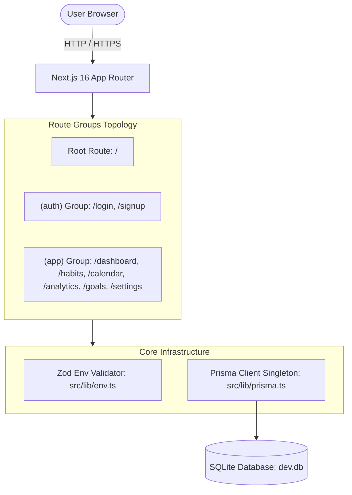
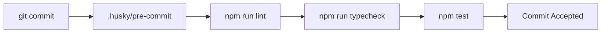

# System Architecture — Daily_Track

This document details the architectural decisions, design patterns, and engineering principles implemented in **Daily_Track**.

---

## 1. Architectural Overview

Daily_Track is constructed using modern full-stack web standards:

- **Presentation Layer**: Next.js App Router with React Server Components (RSC) by default and targeted Client Components (`"use client"`) for interactivity.
- **Styling & Design System**: Tailwind CSS v4 design tokens via CSS custom properties and class-based dark mode.
- **Configuration & Validation**: Fail-fast environment variable validation powered by Zod schemas.
- **Persistence Layer**: Embedded SQLite managed through Prisma ORM with a Hot Module Reloading (HMR) safe singleton client (pinned to Prisma 6.19.3 LTS).
- **Quality Assurance**: Automated linting, type-checking, formatting, and unit testing in top-level `tests/` tied together with Husky pre-commit hooks.



---

## 2. Route Groups & App Router Topology

Next.js route groups (folders enclosed in parentheses) allow logical separation of layouts without introducing extra URL segments:

### 2.1 `(auth)` Group

- **Routes**: `/login`, `/signup`
- **Layout**: Centered card layout with isolated brand header, minimalist footer, and no dashboard navigation bars.
- **Security Boundary**: Dedicated to authentication, guest-only flows, and session initiation.

### 2.2 `(app)` Group

- **Routes**:
  - `/dashboard`: Daily overview, statistics cards, and habit checklist.
  - `/habits`: Habit catalog, category filtering, and streak tracking.
  - `/calendar`: "Coming soon" monthly and weekly habit completion schedule.
  - `/analytics`: "Coming soon" consistency metrics and visual heatmaps.
  - `/goals`: "Coming soon" milestone and long-term target tracking.
  - `/settings`: Theme toggle, SQLite diagnostics, and runtime diagnostics.
- **Layout**: Application layout featuring a persistent navigation bar (desktop header + mobile bottom bar), active navigation state, user avatar, and global theme switch.
- **Security Boundary**: Reserved for authenticated user operations, personal habit logging, and account preferences.

### 2.3 Root Route `/`

- Independent landing and showcase page linking into both `(app)` and `(auth)` groups.

---

## 3. Design System & Theming

### 3.1 Design Tokens via CSS Custom Properties

Rather than hardcoding hex codes, Tailwind CSS v4 maps semantic color tokens directly to CSS custom properties defined in `src/app/globals.css`:

- `--background`, `--foreground`
- `--card`, `--card-foreground`
- `--primary`, `--primary-foreground`
- `--secondary`, `--secondary-foreground`
- `--muted`, `--muted-foreground`
- `--accent`, `--accent-foreground`
- `--destructive`, `--destructive-foreground`
- `--border`, `--input`, `--ring`

### 3.2 Class-Based Dark Mode

Dark mode is activated via the `.dark` class applied to `document.documentElement`:

```css
@custom-variant dark (&:where(.dark, .dark *));
```

### 3.3 Hydration & Anti-FOUC Guarantee

To prevent Flash of Unstyled Content (FOUC):

1. An inline `<script>` in the root `layout.tsx` head inspects `localStorage.getItem('theme')` or `prefers-color-scheme` synchronously before rendering any UI.
2. The `ThemeToggle` component uses React 19's `useSyncExternalStore` to synchronize external DOM and `localStorage` state without causing cascading re-renders.

---

## 4. Database & ORM Architecture

### 4.1 SQLite Storage & Prisma 6.19.3 LTS Pinning Decision

SQLite was chosen for local development and embedded deployment:

- Zero external daemon dependencies.
- Zero network latency for reads/writes.
- Simple file-based backups and migrations.

> [!NOTE]
> **Prisma Version Decision**: In Prisma 7, the `url` property was removed from `schema.prisma` datasource blocks, migrating connection URLs to `prisma.config.ts` and requiring external driver adapters (e.g. `@prisma/adapter-better-sqlite3`, which requires node-gyp native C++ compilation on Windows). To avoid compilation brittleness and maintain zero-configuration SQLite simplicity, Prisma is pinned to **6.19.3 LTS**.

### 4.2 HMR-Safe Prisma Singleton

In Next.js development mode, Turbopack re-evaluates modules on file change. Standard `new PrismaClient()` calls would quickly exhaust connection pools.
The singleton pattern in `src/lib/prisma.ts` preserves the active client instance across module reloads:

```typescript
const globalForPrisma = globalThis as unknown as { prisma: PrismaClient | undefined };
export const prisma = globalForPrisma.prisma ?? new PrismaClient({ ... });
if (env.NODE_ENV !== "production") globalForPrisma.prisma = prisma;
```

---

## 5. Folder Hierarchy & Modular Boundaries

The codebase enforces clear separation of concerns:

- `src/components/ui/`: Primitive, reusable presentational components.
- `src/components/features/`: Complex domain-specific composite widgets.
- `src/hooks/`: Reusable React state and lifecycle hooks.
- `src/lib/`: Cross-cutting utilities, validators, and singletons.
- `src/server/`: Server Actions and server-only data access layer.
- `src/types/`: Shared TypeScript domain models and interfaces.
- `tests/`: Top-level test suites cleanly separated from production source code.

---

## 6. Environment Configuration

All environment variables are validated at runtime and build time using Zod in `src/lib/env.ts`:

- Invalid or missing variables throw immediate descriptive errors with JSON formatting.
- Clean `.env.example` committed to git to document expected variables.
- Active credentials and local database files (`.env`, `*.db`) strictly ignored by `.gitignore`.

---

## 7. Quality Gates & Continuous Verification



- **ESLint 9**: Flat config targeting Next.js core web vitals and TypeScript rules.
- **Prettier 3**: Universal code formatting.
- **TypeScript 5**: Strict type-checking (`noEmit: true`).
- **Vitest 4**: Vite-native testing runner targeting top-level `tests/` directory with `@/` alias resolution.
- **Husky 9**: Automated pre-commit verification hook blocking regressions before they reach the repository.
