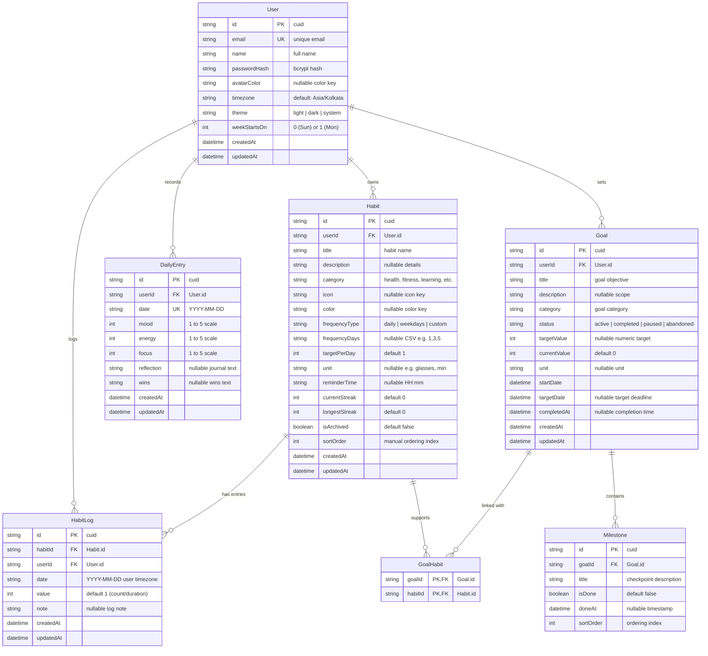

# Data Model & Schema Specification — DailyTrack

This document describes the complete relational data architecture, entity relationships, model attributes, and database-level business rules for **DailyTrack** (Phase 2: Data & Backend).

---

## 1. Entity-Relationship Diagram (ERD)

---

## 2. Model Dictionary

### 2.1 User

Represents a registered user account with localization and personalization preferences.

| Field          | Type       | Attributes                 | Description                                                       |
| -------------- | ---------- | -------------------------- | ----------------------------------------------------------------- |
| `id`           | `String`   | `@id`, `cuid()`            | Unique user identifier.                                           |
| `email`        | `String`   | `@unique`                  | Case-insensitive email address for authentication.                |
| `name`         | `String`   |                            | Display name of the user.                                         |
| `passwordHash` | `String`   |                            | Salted bcrypt hash of user's password.                            |
| `avatarColor`  | `String?`  | Nullable                   | Selected theme color for the user avatar (e.g. `indigo`, `rose`). |
| `timezone`     | `String`   | `@default("Asia/Kolkata")` | IANA timezone used for day boundaries and daily log calculations. |
| `theme`        | `String`   | `@default("system")`       | UI preference: `"light"`, `"dark"`, or `"system"`.                |
| `weekStartsOn` | `Int`      | `@default(1)`              | Calendar start of week: `0` (Sunday) or `1` (Monday).             |
| `createdAt`    | `DateTime` | `@default(now())`          | Account creation timestamp.                                       |
| `updatedAt`    | `DateTime` | `@updatedAt`               | Last profile update timestamp.                                    |

---

### 2.2 Habit

Represents a recurring daily, weekday, or custom-schedule routine.

| Field           | Type       | Attributes           | Description                                                                                             |
| --------------- | ---------- | -------------------- | ------------------------------------------------------------------------------------------------------- |
| `id`            | `String`   | `@id`, `cuid()`      | Unique habit identifier.                                                                                |
| `userId`        | `String`   | `@relation`, Cascade | Foreign key referencing `User.id`.                                                                      |
| `title`         | `String`   |                      | Name of the habit (e.g. "Morning Meditation").                                                          |
| `description`   | `String?`  | Nullable             | Optional context or instructions.                                                                       |
| `category`      | `String`   | Indexed              | Category: `health`, `fitness`, `learning`, `mindfulness`, `productivity`, `finance`, `social`, `other`. |
| `icon`          | `String?`  | Nullable             | Icon key from shared `ICON_KEYS` (e.g. `sun`, `dumbbell`).                                              |
| `color`         | `String?`  | Nullable             | Accent color from shared `COLOR_KEYS` (e.g. `emerald`, `blue`).                                         |
| `frequencyType` | `String`   |                      | Recurrence type: `"daily"`, `"weekdays"`, or `"custom"`.                                                |
| `frequencyDays` | `String?`  | Nullable             | Comma-separated digits `0-6` (0=Sun, 1=Mon, ..., 6=Sat) for custom schedules.                           |
| `targetPerDay`  | `Int`      | `@default(1)`        | Target daily count or unit amount required for completion.                                              |
| `unit`          | `String?`  | Nullable             | Metric label (e.g. `glasses`, `minutes`, `pages`).                                                      |
| `reminderTime`  | `String?`  | Nullable             | Optional reminder timestamp in `"HH:mm"` 24-hour format.                                                |
| `currentStreak` | `Int`      | `@default(0)`        | Current consecutive active streak (stubbed for Phase 5 calculation).                                    |
| `longestStreak` | `Int`      | `@default(0)`        | All-time highest streak count (stubbed for Phase 5 calculation).                                        |
| `isArchived`    | `Boolean`  | `@default(false)`    | Flag hiding habit from active daily views while preserving history.                                     |
| `sortOrder`     | `Int`      |                      | Zero-based index for custom drag-and-drop dashboard display.                                            |
| `createdAt`     | `DateTime` | `@default(now())`    | Creation timestamp.                                                                                     |
| `updatedAt`     | `DateTime` | `@updatedAt`         | Last modification timestamp.                                                                            |

---

### 2.3 HabitLog

Represents a recorded completion or progress entry for a habit on a specific date.

| Field       | Type       | Attributes           | Description                                                     |
| ----------- | ---------- | -------------------- | --------------------------------------------------------------- |
| `id`        | `String`   | `@id`, `cuid()`      | Unique log identifier.                                          |
| `habitId`   | `String`   | `@relation`, Cascade | Foreign key referencing `Habit.id`.                             |
| `userId`    | `String`   | `@relation`, Cascade | Foreign key referencing `User.id` for fast user-scoped queries. |
| `date`      | `String`   | Indexed              | Calendar date in `"YYYY-MM-DD"` format (in user's timezone).    |
| `value`     | `Int`      | `@default(1)`        | Completed amount (e.g. `3` glasses of water, `1` session).      |
| `note`      | `String?`  | Nullable             | Optional contextual reflection on this specific completion.     |
| `createdAt` | `DateTime` | `@default(now())`    | Creation timestamp.                                             |
| `updatedAt` | `DateTime` | `@updatedAt`         | Last modification timestamp.                                    |

**Constraints & Indexes**:

- `@@unique([habitId, date])`: Enforces at most one log entry per habit per calendar day. Upserting updates `value` and `note`.
- `@@index([userId, date])`: Optimized for rapid retrieval of the entire daily journal and all daily habit statuses.

---

### 2.4 DailyEntry

Represents the user's daily check-in, mood tracker, energy ratings, and journal.

| Field        | Type       | Attributes           | Description                                           |
| ------------ | ---------- | -------------------- | ----------------------------------------------------- |
| `id`         | `String`   | `@id`, `cuid()`      | Unique entry identifier.                              |
| `userId`     | `String`   | `@relation`, Cascade | Foreign key referencing `User.id`.                    |
| `date`       | `String`   | Indexed              | Calendar date in `"YYYY-MM-DD"` format.               |
| `mood`       | `Int?`     | Nullable             | Subjective mood score from 1 (lowest) to 5 (highest). |
| `energy`     | `Int?`     | Nullable             | Subjective energy level from 1 to 5.                  |
| `focus`      | `Int?`     | Nullable             | Subjective focus rating from 1 to 5.                  |
| `reflection` | `String?`  | Nullable             | Free-form journal entry or end-of-day summary.        |
| `wins`       | `String?`  | Nullable             | Highlights or achievements for the day.               |
| `createdAt`  | `DateTime` | `@default(now())`    | Creation timestamp.                                   |
| `updatedAt`  | `DateTime` | `@updatedAt`         | Last modification timestamp.                          |

**Constraints & Indexes**:

- `@@unique([userId, date])`: One entry per user per calendar day.
- `@@index([userId, date])`: Range indexing for analytics and history views.

---

### 2.5 Goal

Represents a high-level target or milestone-driven project.

| Field          | Type        | Attributes           | Description                                                      |
| -------------- | ----------- | -------------------- | ---------------------------------------------------------------- |
| `id`           | `String`    | `@id`, `cuid()`      | Unique goal identifier.                                          |
| `userId`       | `String`    | `@relation`, Cascade | Foreign key referencing `User.id`.                               |
| `title`        | `String`    |                      | Title of the goal.                                               |
| `description`  | `String?`   | Nullable             | Detailed motivation or breakdown.                                |
| `category`     | `String`    |                      | Goal category matching or extending habit categories.            |
| `status`       | `String`    | Indexed              | Lifecycle: `"active"`, `"completed"`, `"paused"`, `"abandoned"`. |
| `targetValue`  | `Int?`      | Nullable             | Target numeric metric (e.g. `12` books, `10` km).                |
| `currentValue` | `Int`       | `@default(0)`        | Current progress toward `targetValue`.                           |
| `unit`         | `String?`   | Nullable             | Unit label (e.g. `books`, `kg`, `%`).                            |
| `startDate`    | `DateTime`  |                      | Target start date.                                               |
| `targetDate`   | `DateTime?` | Nullable             | Target deadline.                                                 |
| `completedAt`  | `DateTime?` | Nullable             | Completion timestamp.                                            |
| `createdAt`    | `DateTime`  | `@default(now())`    | Creation timestamp.                                              |
| `updatedAt`    | `DateTime`  | `@updatedAt`         | Last modification timestamp.                                     |

---

### 2.6 Milestone

Sub-checkpoints supporting a specific goal.

| Field       | Type        | Attributes           | Description                              |
| ----------- | ----------- | -------------------- | ---------------------------------------- |
| `id`        | `String`    | `@id`, `cuid()`      | Unique milestone identifier.             |
| `goalId`    | `String`    | `@relation`, Cascade | Foreign key referencing `Goal.id`.       |
| `title`     | `String`    |                      | Checkpoint label.                        |
| `isDone`    | `Boolean`   | `@default(false)`    | Checkpoint completion flag.              |
| `doneAt`    | `DateTime?` | Nullable             | Timestamp when marked completed.         |
| `sortOrder` | `Int`       |                      | Sequencing index within the parent goal. |

---

### 2.7 GoalHabit (Join Table)

Associates habits to the high-level goals they support (many-to-many relationship).

| Field     | Type     | Attributes     | Description                         |
| --------- | -------- | -------------- | ----------------------------------- |
| `goalId`  | `String` | `@id`, Cascade | Foreign key referencing `Goal.id`.  |
| `habitId` | `String` | `@id`, Cascade | Foreign key referencing `Habit.id`. |

**Primary Key**: Composite `@@id([goalId, habitId])`.

---

## 3. Database Rules & Cascade Semantics

1. **User Deletion**:
   - Deleting a `User` cascades and permanently deletes all related `Habit`, `HabitLog`, `DailyEntry`, `Goal`, and `GoalHabit` records.
2. **Habit Deletion**:
   - Deleting a `Habit` cascades and deletes all its `HabitLog` records and its join rows in `GoalHabit`.
3. **Goal Deletion**:
   - Deleting a `Goal` cascades and deletes all child `Milestone` records and its join rows in `GoalHabit`.
4. **Idempotent Day Upserting**:
   - Daily logs and journal entries use deterministic `YYYY-MM-DD` composite constraints preventing race conditions or duplicated submissions on the same calendar day.
5. **No Native SQLite Enums**:
   - String columns with runtime Zod enforcement ensure effortless future migration to PostgreSQL or MySQL without schema alteration risks.
